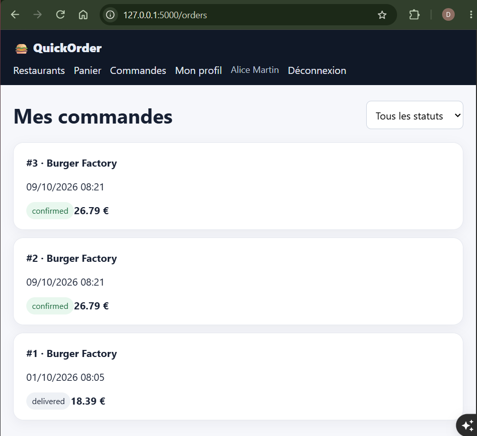
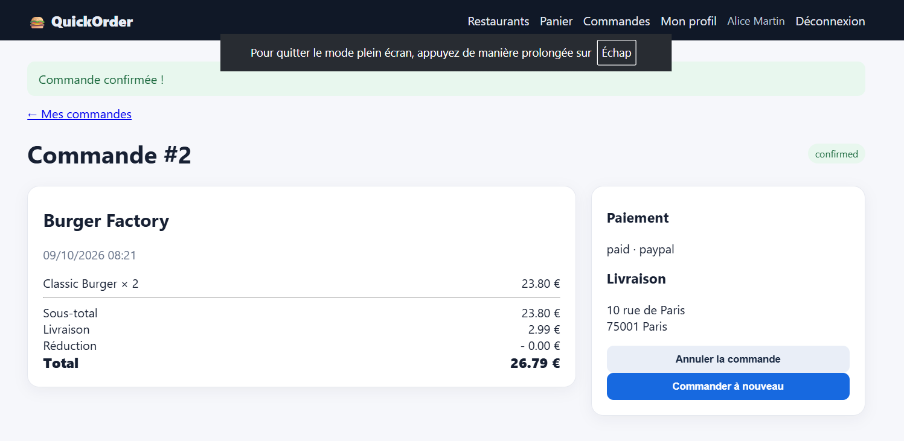

# BUG-01 : Un paiement PayPal crée deux commandes identiques et payées

Sévérité critique, priorité P1. Cas de test lié : TC-R04. Statut : ouvert.

## Contexte
Client alice@example.com, UI et API.

## Préconditions
Panier contenant 2 Classic Burger (Burger Factory).

## Étapes de reproduction
1. Ouvrir /checkout.
2. Choisir l'adresse Domicile et le paiement PayPal.
3. Cliquer sur "Confirmer".
4. Ouvrir /orders.

## Résultat attendu
Une seule commande, un seul paiement de 26,79 €.

## Résultat obtenu
Deux commandes identiques (26,79 € chacune, statut confirmed / paid) apparaissent. Le stock est décrémenté deux fois. Même comportement via POST /api/orders avec `payment_method: paypal`.

## Preuve
Exécution du 09/10/2026, un seul clic sur "Confirmer" : les commandes #2 et #3 sont créées, identiques.

Contenu de la table `order` après le clic :

| # | Statut | Paiement | Référence | Total | Créée à |
|---|---|---|---|---|---|
| 2 | confirmed | paid · paypal | PAY-2D7C3E8F3D | 26,79 € | 08:21:38.958 |
| 3 | confirmed | paid · paypal | PAY-1FE6D3554D | 26,79 € | 08:21:38.969 |

Deux références de paiement distinctes à 11 ms d'intervalle : le client est débité deux fois.

## Cause probable
`app/routes/orders.py` l.118-124 et `app/routes/api.py` l.200-210 : un second `build_order` / `Order` est créé quand le paiement est PayPal.
