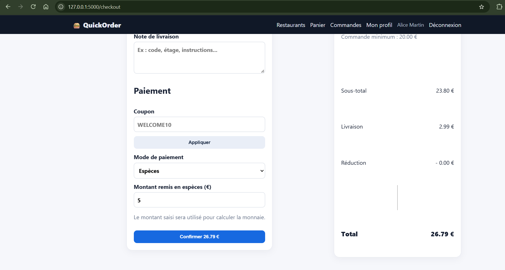
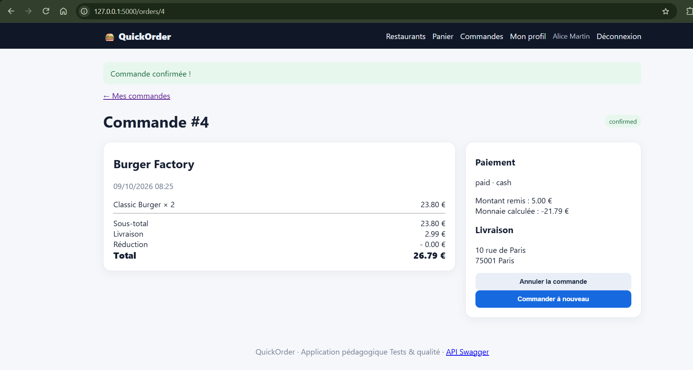

# BUG-02 : Paiement en espèces accepté avec un montant inférieur au total

Sévérité majeure, priorité P1. Cas de test lié : TC-E04. Statut : ouvert.

## Contexte
Client alice@example.com.

## Préconditions
Panier 23,80 € chez Burger Factory (total 26,79 €).

## Étapes de reproduction
1. Ouvrir /checkout.
2. Choisir "Espèces" et saisir 5 dans le montant remis.
3. Confirmer.

## Résultat attendu
Refus : "Le montant remis doit être supérieur ou égal au total".

## Résultat obtenu
Commande confirmée et marquée payée. Rendu monnaie affiché à -21,79 €. Un montant vide ou non numérique est converti en 0 et accepté.

## Preuve
Exécution du 09/10/2026 : 5 € saisis pour un total de 26,79 €, commande #4 confirmée et marquée payée.

## Cause probable
`app/routes/orders.py` l.34-40 : aucune comparaison entre `cash_received` et `total`.
