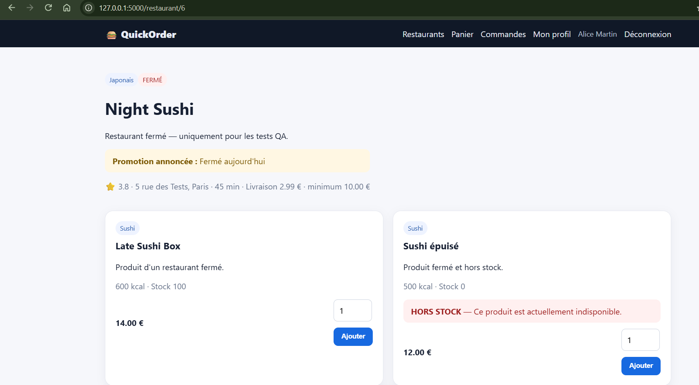
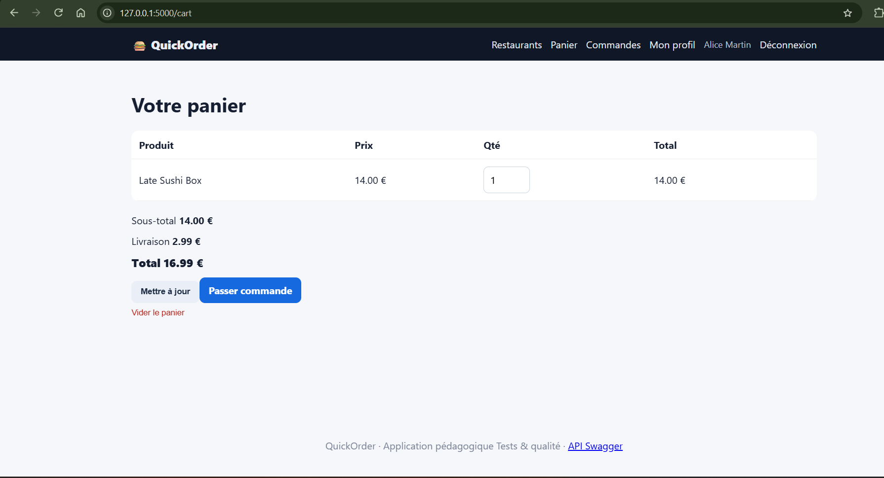
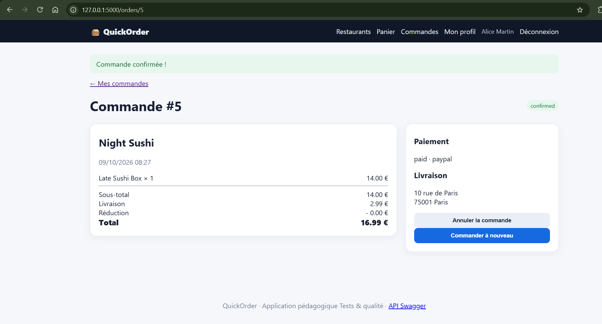

# BUG-03 : Un restaurant fermé peut recevoir des commandes

Sévérité majeure, priorité P1. Cas de test lié : TC-R02. Statut : ouvert.

## Contexte
Client alice@example.com.

## Préconditions
Night Sushi est fermé (is_open = false). Panier vide.

## Étapes de reproduction
1. Ouvrir la fiche Night Sushi.
2. Ajouter "Late Sushi Box".
3. Checkout, paiement PayPal, confirmer.

## Résultat attendu
Ajout au panier bloqué avec un message "Restaurant fermé".

## Résultat obtenu
Produit ajouté, commande confirmée et payée. L'API `GET /api/restaurants` liste aussi Night Sushi sans filtre et `POST /api/orders` l'accepte.

## Preuve
Exécution du 09/10/2026 : Night Sushi est affiché "FERMÉ" (`is_open = 0` en base), mais l'ajout au panier et la commande passent.

Paiement fait en PayPal : BUG-01 s'est reproduit au passage, avec la création d'une commande #6 identique (16,99 €, 6 ms plus tard).

## Cause probable
`app/routes/shop.py` l.16-27 et `app/routes/orders.py` l.104-105 : `restaurant.is_open` n'est jamais vérifié.
