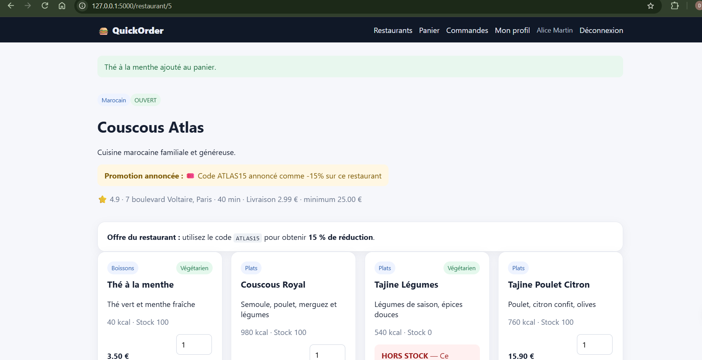
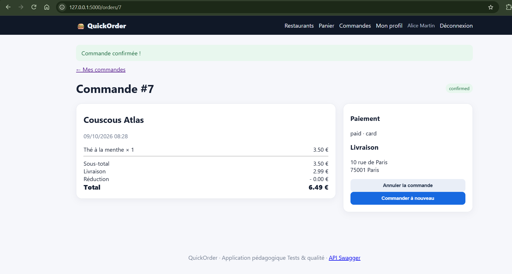

# BUG-04 : Le minimum de commande affiché n'est pas appliqué

Sévérité majeure, priorité P1. Cas de test lié : TC-R03. Statut : ouvert.

## Contexte
Client alice@example.com.

## Préconditions
Couscous Atlas, minimum affiché 25 €. Panier vide.

## Étapes de reproduction
1. Ajouter "Thé à la menthe" (3,50 €).
2. Checkout, carte, confirmer.

## Résultat attendu
Refus : "Minimum de commande de 25,00 € non atteint".

## Résultat obtenu
Commande confirmée à 6,49 € (3,50 + 2,99 livraison). Idem via l'API.

## Preuve
Exécution du 09/10/2026 : minimum affiché 25,00 €, commande #7 confirmée et payée par carte pour un sous-total de 3,50 €.

## Cause probable
`app/routes/orders.py` l.106 et `app/routes/api.py` l.180 : `minimum_order` n'est jamais comparé au sous-total.
