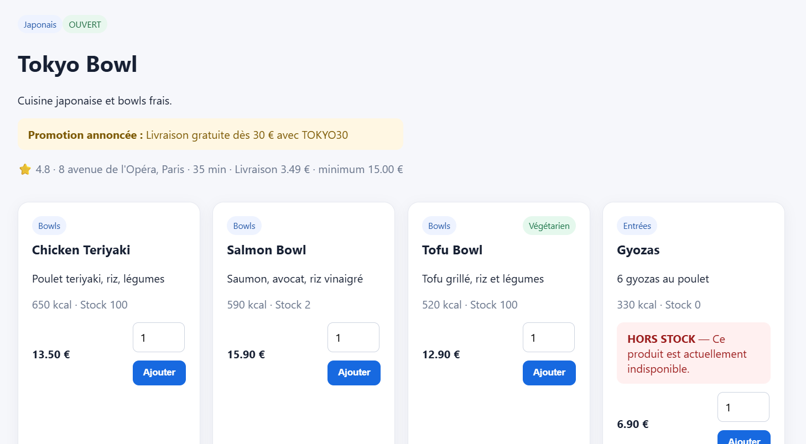
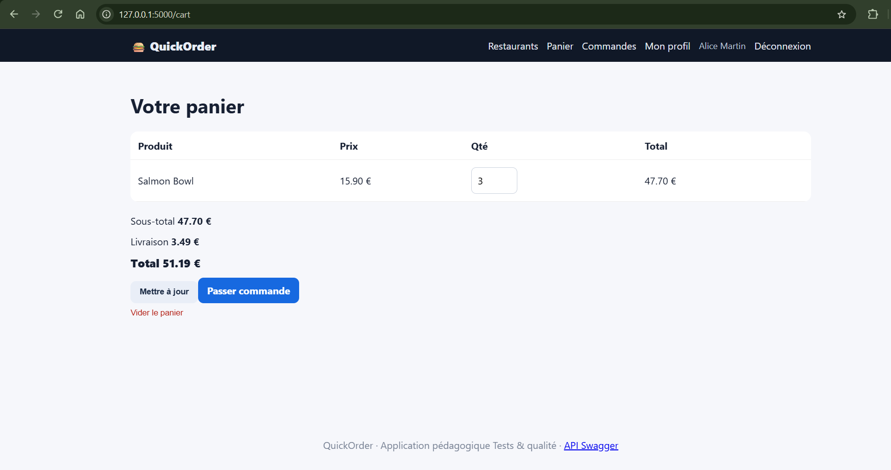
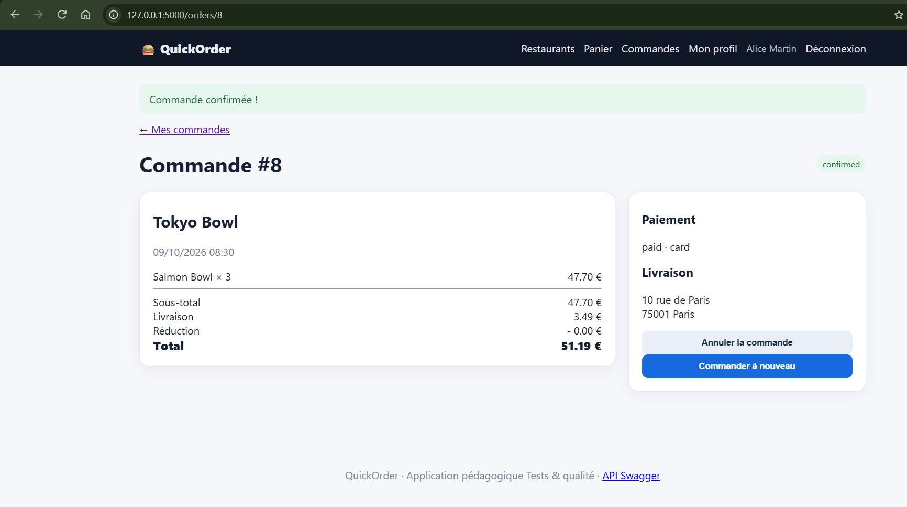

# BUG-05 : Le stock n'est pas contrôlé : produits épuisés commandables, stock négatif

Sévérité majeure, priorité P1. Cas de test lié : TC-L05. Statut : ouvert.

## Contexte
Client alice@example.com.

## Préconditions
Salmon Bowl stock = 2. Gyozas stock = 0.

## Étapes de reproduction
1. Ajouter Salmon Bowl quantité 3 (ou Gyozas quantité 1).
2. Checkout, carte, confirmer.
3. GET /api/products/{id} dans Swagger.

## Résultat attendu
Ajout refusé ou quantité plafonnée au stock. Les produits à stock 0 sont signalés "épuisé".

## Résultat obtenu
Produits épuisés affichés comme commandables, commande acceptée, `stock` passe à -1.

## Preuve
Exécution du 09/10/2026 : Salmon Bowl (stock 2) commandé en quantité 3, commande #8 confirmée, stock à -1.

Après la commande, l'API renvoie `"stock": -1` ([BUG-05-api.txt](../evidence/BUG-05-api.txt)).

## Cause probable
`app/routes/main.py` l.49-50 (pas de filtre stock), `app/routes/shop.py` l.38, `app/routes/orders.py` l.68-69, `app/routes/api.py` l.159.
