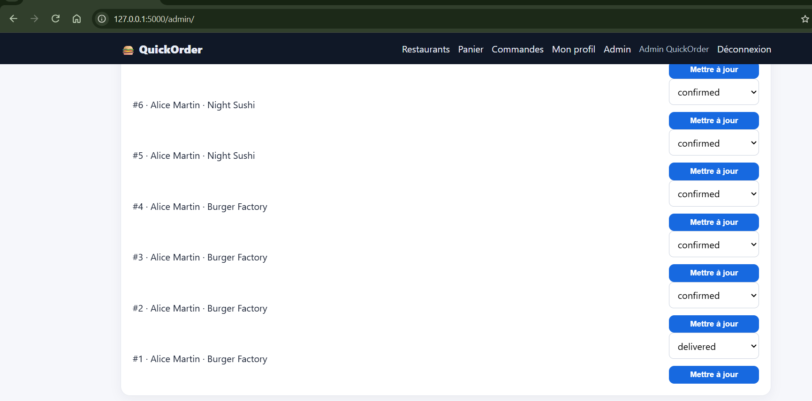
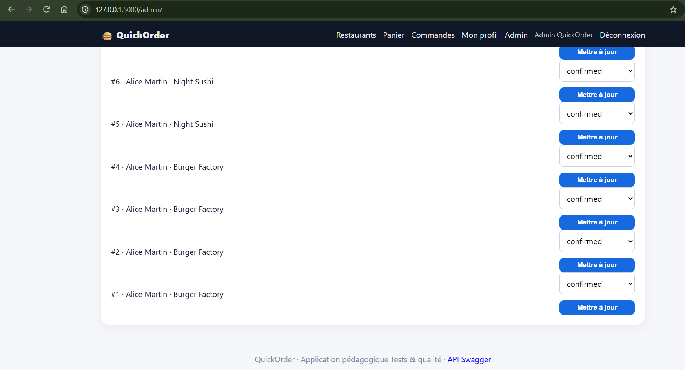

# BUG-08 : L'admin peut faire revenir une commande livrée à un statut antérieur

Sévérité majeure, priorité P2. Cas de test lié : TC-R06. Statut : ouvert.

## Contexte
Admin admin@quickorder.local.

## Préconditions
Commande 1 au statut delivered.

## Étapes de reproduction
1. Ouvrir /admin.
2. Sur la commande 1, choisir "confirmed".
3. Valider.

## Résultat attendu
Refus : une commande livrée ne doit pas pouvoir repasser en confirmed.

## Résultat obtenu
Message "Statut mis à jour". La commande repasse confirmed et redevient annulable par le client.

## Preuve
Exécution du 09/10/2026 : commande #1 passée de `delivered` à `confirmed` sans message d'erreur (vérifié en base : status = confirmed).

## Cause probable
`app/routes/admin.py` l.34-40 : seule l'appartenance à la liste est vérifiée, pas le statut courant.
