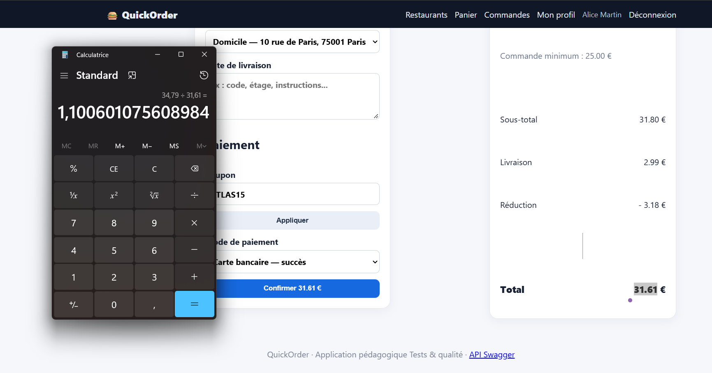

# BUG-09 : Le code ATLAS15 annoncé à -15 % n'applique que -10 %

Sévérité majeure, priorité P2. Cas de test lié : TC-R05. Statut : ouvert.

## Contexte
Client alice@example.com.

## Préconditions
Bandeau Couscous Atlas : "Code ATLAS15 annoncé comme -15 %".

## Étapes de reproduction
1. Ajouter 2 Tajine Poulet Citron (sous-total 31,80 €).
2. Checkout, saisir ATLAS15.

## Résultat attendu
Réduction de 4,77 € (15 % de 31,80 €), total 30,02 €.

## Résultat obtenu
Réduction de 3,18 € (10 %), total 31,61 €. Publicité trompeuse pour le client.

## Preuve
Exécution du 09/10/2026 : panier de 31,80 €, réduction appliquée de 3,18 € (10 %) au lieu de 4,77 € (15 %). Taux réellement appliqué : 3,18 / 31,80 = 10 %.

## Cause probable
Donnée : `seed.py`, coupon ATLAS15 stocké avec `discount_percent = 10`.
