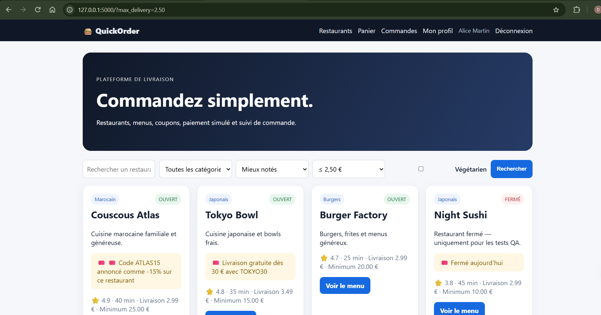

# BUG-10 : Le filtre "frais de livraison max" renvoie les restaurants les plus chers

Sévérité moyenne, priorité P2. Cas de test lié : TC-L06. Statut : ouvert.

## Contexte
Visiteur.

## Préconditions
Base seedée.

## Étapes de reproduction
1. Accueil, filtre frais de livraison max = 2,50 € (/?max_delivery=2.50).

## Résultat attendu
Green Kitchen (1,99 €) et Pizza Roma (2,49 €).

## Résultat obtenu
Burger Factory, Tokyo Bowl, Couscous Atlas, Night Sushi : tous >= 2,50 €.

## Preuve
Exécution du 09/10/2026 avec le filtre "<= 2,50 €" (`/?max_delivery=2.50`) : la liste affiche Couscous Atlas, Burger Factory, Night Sushi (2,99 €) et Tokyo Bowl (3,49 €), tous au-dessus de 2,50 €. Les deux seuls restaurants attendus, Green Kitchen (1,99 €) et Pizza Roma (2,49 €), sont absents.

## Cause probable
`app/routes/main.py` l.24-25 : `delivery_fee >= max_delivery` au lieu de `<=`.
